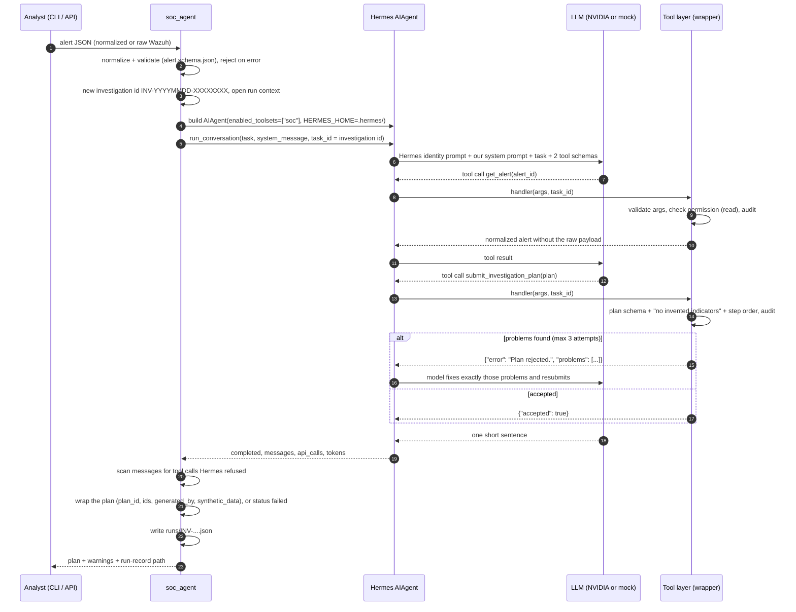

# Architecture: Hermes-powered AI SOC analyst (Day 1)

The system receives a security alert. An agent running on the Hermes agent runtime plans the investigation, using only approved tools. Hermes is the **orchestration layer only**: it decides which approved tool to call next. It is **not** the SIEM, the log collector or the detection engine. Wazuh and tshark-based detections produce the alerts; the agent works on what they report.

## 1. Components

```mermaid
flowchart LR
    subgraph SIEM["SIEM / detection layer: detects"]
        W["Wazuh<br/>auth.log rules, e.g. 40112"]
        T["tshark<br/>network session exports"]
    end

    subgraph APP["soc_agent application (this repo)"]
        IN["Alert intake<br/>CLI / FastAPI"]
        N["Normalize + validate<br/>alert.schema.json"]
        P["Planner<br/>run lifecycle, final checks"]
        REC[("Run records<br/>runs/INV-....json<br/>SQLite audit on Day 4")]
    end

    subgraph HERMES["Hermes agent runtime: decides"]
        H["AIAgent loop<br/>toolset = soc only"]
    end

    LLM[("LLM<br/>NVIDIA NIM: nemotron-3.5-lightning-30b-a3b<br/>or offline MOCK script")]

    subgraph TOOLS["Tool layer: retrieves / records"]
        WR{{"One wrapper for every tool:<br/>1 find run by task_id<br/>2 validate args (JSON schema)<br/>3 check permission<br/>4 run, catch errors<br/>5 audit entry"}}
        G["get_alert (read)"]
        S["submit_investigation_plan<br/>(write_internal)"]
        D2["Day 2: search_logs, lookup_ip,<br/>search_cve, get_asset_context (read)"]
        X["disruptive actions<br/>(block, disable, isolate)<br/>DENIED, approval workflow on Day 4"]
    end

    A["Human analyst"]

    W -- alert JSON --> IN
    T -. Day 2 evidence .-> D2
    W -. Day 2 evidence .-> D2
    IN --> N --> P --> H
    H <--> LLM
    H -- tool call --> WR
    WR --> G & S & D2
    WR -. denied .-> X
    WR -- audit --> REC
    P -- run record --> REC
    P -- validated plan --> A
    A -. approves / rejects .-> X
```

### Responsibilities

| Layer | Responsible for | Not responsible for |
|---|---|---|
| **SIEM / detection** (Wazuh, tshark-based detections) | Collecting events, deterministic detection rules, raising alerts with a severity claim and MITRE hints | Investigating, deciding on a response |
| **Hermes agent runtime** (`hermes-agent` 0.19.0) | Running the agent loop: sending the task and tool schemas to the LLM, dispatching the tool calls the model chooses, feeding results back, stopping at the step limit | Detecting, storing evidence, running anything outside the `soc` toolset |
| **LLM** (NVIDIA NIM, or the mock) | Choosing the next tool and writing the plan content | Talking to any system directly. It can only ask Hermes to call a tool |
| **Tool layer** (`src/soc_agent/tools/`) | Narrow functions with JSON-schema arguments; validation, permission check and an audit entry on every call; returning errors as JSON so the model can correct itself | Making decisions |
| **Application** (`alerts.py`, `planner.py`, `cli.py`, `api.py`) | Alert intake and normalization, run ids, building the locked-down agent, accepting a plan only via the tool, writing run records | Letting the model bypass validation; making up a plan when the model fails |
| **Human analyst** | Reviewing plans and reports; approving or rejecting any disruptive action | n/a |

**Why this split:** detection must stay deterministic and testable, which is the SIEM's job. The LLM is used only where judgement helps (planning, choosing tools, connecting evidence). Everything it produces passes schema validation before anyone relies on it.

## 2. Day 1 flow: alert to investigation plan

If the model never gets a plan accepted, or the LLM call fails, the result is `status: "failed"` with the error. The application never fills in a plan itself.

## 3. Input and output contracts

| Contract | File | Key rules |
|---|---|---|
| Alert (input) | [`schemas/alert.schema.json`](../schemas/alert.schema.json) | draft 2020-12, `additionalProperties: false` at every level; timestamp in UTC; IPv4 checked; `synthetic` required; `severity_hint` is the source's claim, not our assessment |
| Investigation plan (agent output) | [`schemas/investigation_plan.schema.json`](../schemas/investigation_plan.schema.json) | 2-6 hypotheses with at least one `benign: true`; 3-10 key questions; 3-12 steps numbered 1..n, each naming an approved tool (`search_logs`, `lookup_ip`, `search_cve`, `get_asset_context`, `analyst_review`); 1-6 safety notes; data gaps |
| Final plan (application output) | built in `planner.py` | agent content + `plan_id`, `investigation_id`, `alert_id`, `created_at`, `generated_by {runtime, provider, model, mock}`, `synthetic_data` |
| Run record (audit) | `runs/<investigation_id>.json` | task (system prompt + user message), exposed tools, every tool call, calls refused by Hermes, Hermes stats, warnings, outcome |

Raw Wazuh alerts are mapped as follows: `rule.level` becomes `severity_hint` (13 or more: critical, 10 or more: high, 6 or more: medium, otherwise low; missing: unknown), `data.dstuser` becomes the account, `data.srcip` the source IP, `agent.name` the host, and `rule.mitre.id` is kept as `mitre_hint`. The original is kept under `raw`, which is never sent to the LLM.

## 4. Security model (least privilege by configuration, not by prompt)

| Control | How | Proved by (tests/) |
|---|---|---|
| Only approved tools are visible to the model | Tools registered in Hermes's registry under toolset `soc`; agent built with `enabled_toolsets=["soc"]`; registration fails loudly if Hermes refuses a name | `test_only_soc_tools_are_exposed`, `test_cli[check]` |
| Hermes built-in tools are unreachable | A model call to e.g. `terminal` is refused by Hermes ("Tool 'terminal' does not exist"), recorded as `refused_by_hermes`, and nothing runs | `test_escape_to_builtin_terminal_is_refused` (marker file never created) |
| Arguments validated before execution | JSON schema with `additionalProperties: false`, checked by the wrapper before the handler; the exact problems go back to the model | `test_wrapper_validates_arguments_before_the_handler_and_audits`, `test_malformed_tool_arguments_are_rejected_then_recovered` |
| Permission levels | Every tool is `read`, `write_internal` or `disruptive`; runs allow only `read` and `write_internal` | `test_disruptive_tool_is_denied` |
| Tool failures can't crash the agent | Wrapper catches all exceptions and returns `{"error": ...}` | `test_tool_exceptions_become_errors` |
| Every call is audited | seq, tool, permission, arguments, status (ok / rejected / denied / error), result, timestamps, duration | `test_wrapper_validates_arguments_before_the_handler_and_audits`, `test_normal_alert_to_plan` |
| No invented indicators | IPs, accounts and hosts in step parameters (including nested values) must appear in the alert | `test_plan_may_not_invent_indicators`, `test_invalid_plan_is_rejected_then_fixed` |
| Benign hypothesis required | Plan schema `contains benign: true`, enforced by the handler | `test_full_schema_still_applies_behind_the_simplified_model_schema` |
| One plan, limited retries | Max 3 submissions; only one accepted plan per run | `test_only_one_accepted_plan`, `test_plan_attempts_are_limited` |
| Never fabricate a plan | No accepted plan, or an LLM failure, gives `status: failed` | `test_no_submitted_plan_means_failed_not_invented`, `test_llm_outage_fails_safely` |
| Data minimization | `get_alert` drops the raw payload; only synthetic data is used | `test_get_alert_minimizes_data_and_refuses_other_alerts` |
| Isolation from the user's Hermes setup | `HERMES_HOME` set to the project-local `.hermes/` before Hermes is imported; `skip_memory`, `skip_context_files` | `test_hermes_home_is_project_local_not_user_home` |
| Step limit | `max_iterations` (default 6) per task | configuration (`SOC_MAX_ITERATIONS`) |
| Secrets | Read from the environment / `.env` only; `.env` git-ignored; scanner in tests and CI | `test_secret_scanner_*`, `test_git_ignores_env_files`, `test_missing_nvidia_key_is_a_clear_error` |
| Safe run lookup | `GET /runs/{id}` accepts only `INV-YYYYMMDD-XXXXXXXX` and resolves inside `runs/` | `test_run_lookup_blocks_path_traversal`, `test_run_lookup_rejects_malformed_ids` |
| Mock is never presented as AI | `[MOCK]` text, `generated_by.mock = true`, a warning, a CLI banner | `test_normal_alert_to_plan`, `test_cli[plan-mock]` |

Notes:
- Hermes prepends its own general-purpose identity prompt, which mentions tools such as skills. Our system prompt states that only `get_alert` and `submit_investigation_plan` exist. The real guarantee is the toolset, not the prompt.
- The model is sent a slightly simplified plan schema (no `contains` / `pattern` / `format` keywords, which some OpenAI-compatible backends reject in tool definitions). The handler re-validates every plan against the full schema.

## 5. Data sources (Day 2)

- **Wazuh:** authentication events (sshd failures and successes from `auth.log`), sudo, new users. This is where the **outcome** of each login attempt comes from.
- **tshark:** network view exported from lab packet captures: connections from the source IP to port 22 (count, timing, duration, bytes), other targets, and network activity after the login. **SSH is encrypted**, so tshark can show connection volume and timing but **cannot** tell a failed password from a successful one. That comes from Wazuh / `auth.log`. tshark complements Wazuh; it does not replace it.
- **Intelligence:** `lookup_ip` / `search_cve` will read local fixtures labelled `MOCK` in every result, unless an approved API is provided.

See [`data/logs/README.md`](../data/logs/README.md).
